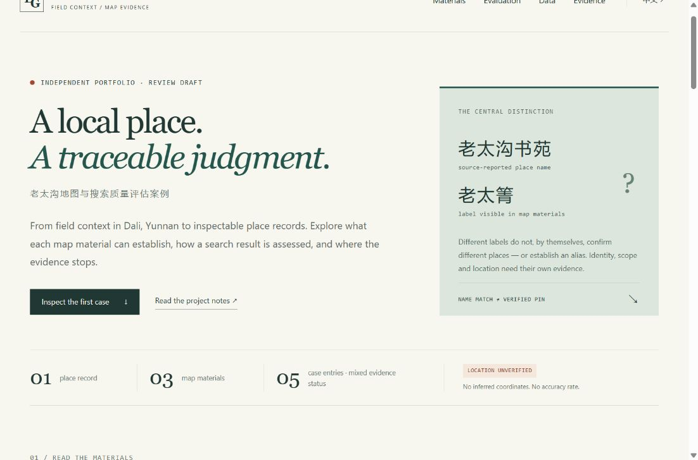

# Laotaigou Mapping & Search Quality Evaluation Case Study

[中文版](README.zh-CN.md) · [Browser viewer](site/index.html) · [First case](cases/C01.md) · [Data sample](data/places.json) · [Evidence](evidence/README.md)

**Evidence-first draft v0.2 · 16 November 2026 · Repository upload approved; geographic verification pending.**

This independent personal portfolio explores how local field knowledge can support map-search evaluation. It is not affiliated with, employed by, endorsed by, or produced for OneForma. No recruitment tests, confidential guidelines or client data are used. The rating rubric is self-designed.

## One-minute overview

The researcher reports field observation, volunteering, interviews and cultural documentation around a community reading space in Dali, Yunnan. This project turns those experiences into inspectable place records and evaluation reasoning. The current evidence supports a **historically reported place**, not a verified current map pin.

- **Available:** one source-backed place record; a bilingual browser evidence viewer; three original-file metadata records; five explicitly classified query exercises; a source register, field dictionary, issue log and runnable checks.
- **Key finding:** “老太沟书苑” is the name reported in an August 2026 article. The same article describes its location using “老太箐村”. This does not establish that 老太沟 and 老太箐 are equivalent place names.
- **Unknown:** precise location, verified administrative village, current operation, confirmed aliases and rights to redistribute historical map images.
- **Next:** researcher review, location evidence and image permissions; then geolocated mapping and genuinely independent cases where evidence permits.

The browser viewer combines the three materials through tabs, zoom/pan and evidence comparisons, **without georeferencing or a navigable pin**. Original images can be selected locally in the browser without upload; they are excluded from the repository pending rights/privacy review. A separate loopback-only review can show the supplied originals. The repository's material summaries remain available without those files. The viewer is not a Leaflet/GIS navigation map.

| Exercise | Evidence scope | Status |
|---|---|---|
| [C01](cases/C01.md) named entity | Historical public report | Full draft, researcher review pending |
| [C02](cases/C02.md) possible name relationship | Report and image labels | Evidence-boundary exercise, alias U |
| [C03](cases/C03.md) functional category | Same report and place as C01 | Reframing, not independent corroboration |
| [C04](cases/C04.md) locality versus entrance | Actual screenshot labels | Evidence-boundary exercise, location U |
| [C05](cases/C05.md) present water condition | Undated hand-drawn depiction | Pending dated current-condition evidence |

These are **not five independently verified field cases or five observed platform errors**. The queries are designed exercises, not recruitment tasks or captured search logs. No coordinates have been guessed.



## Five-minute review

1. Read [C01](cases/C01.md): intent, candidate provenance, separate relevance and accuracy decisions, evidence, limitations and English explanation.
2. Inspect [LTG-P001](data/places.json), the [field dictionary](docs/data-dictionary.md) and [claims](evidence/claims.json).
3. Check [name research](docs/name-check.md), [material inventory](docs/material-inventory.md) and [quality issues](quality/issues.json).
4. Review [official role research and capability mapping](docs/roles.md), [MVP plan](docs/mvp-plan.md) and [methods](docs/methods.md).

## Contribution and attribution

The researcher's observation, volunteering and interviewing background is **self-reported in the project brief**. Exact dates, authorship of the recovered hand-drawn map, interview roles and ownership of photographs remain to be confirmed. Historical AI-assisted reports are not treated as original observation evidence.

AI assistance in this draft: searching accessible chats and files, inspecting available images, researching public sources, proposing the data model and rubric, drafting the case and bilingual text, and writing and checking the Python utilities. The researcher has not yet reviewed the factual decisions or demonstrated independent use of these utilities. This draft does not claim GIS, programming or professional rating proficiency on their behalf.

## Run locally

Python 3.10+ and the standard library are sufficient. No packages, API keys, account or network access are needed to check the saved draft.

```sh
python scripts/qa.py
python -m unittest discover -s tests -v
python -B scripts/build_site.py
python -B scripts/check_site.py
python -m http.server --bind 127.0.0.1 --directory . 8765
```

The first command checks structural consistency, prints unresolved limitations and returns a nonzero exit code for structural errors. An unknown coordinate is an allowed null, not a factual error. Passing checks does not prove real-world accuracy, consent or permission to publish.

Then open `http://127.0.0.1:8765/site/`. GitHub's file view displays source rather than running HTML. [Run/deploy notes](docs/run-and-deploy.md) explain the local server, browser-local image selection, CI and future GitHub Pages work. [validation.json](quality/validation.json) records data-check results. Buildless means no JavaScript bundler; the Python build command only assembles review data.

## Public release

The researcher approved uploading this v0.2 package to the public repository `wanghawthorne-creator/map` on 16 November 2026 after seeing the preview and review package. This is permission to publish the draft, not confirmation of the geographic judgments or permission to redistribute originals. [Review scope](docs/review-before-release.md). Private source files, full transcripts and original map images are absent. GitHub Pages is not enabled by this upload. Code and third-party content have separate [licensing notes](LICENSE.md). No accuracy percentage or project impact is claimed.
